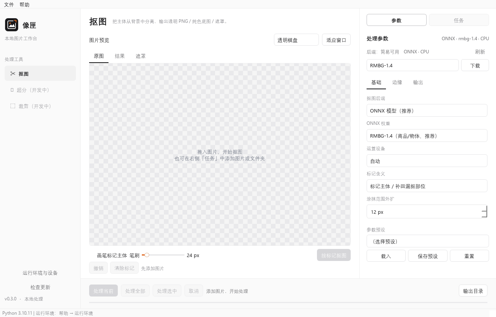

# 像匣 ImageBox · 图片处理工具箱

模块化的图片处理工具，Python + PySide6。每个处理能力都是一个可插拔模块，
共用同一套「输入 → 处理 → 输出」引擎和同一个 UI 外壳。

项目仓库：[weizhigao21/ImageBox](https://github.com/weizhigao21/ImageBox) · [发行版页面](https://github.com/weizhigao21/ImageBox/releases)

## v0.3.1 输出目录记忆（2026-10-16）

在「参数 → 输出」选择或输入输出目录后，自动写入 `config/settings.json`，下次启动恢复。清空后恢复按时间戳自动创建输出目录；载入预设和重置参数也会更新已保存目录。
源码运行的配置文件位于项目根目录下，便携版位于 `ImageBox.exe` 同目录的 `config` 文件夹。配置不存在时，首次修改输出目录会自动创建；可参考 [配置示例](config/settings.example.json)。
`matting.out_dir` 是抠图界面保存的指定目录；顶层 `output_dir` 是留空时自动输出的根目录（默认 `output`）。更新软件时保留配置。

## v0.3 更新功能（2026-10-15）

项目名为「像匣（ImageBox）」。左侧与帮助菜单提供「检查更新」，支持填写 GitHub 发布仓库、后台检查、更新说明、下载与取消。
源码模式只下载；打包后的 ImageBox.exe 可安装更新并重启，保留配置、模型与输出，失败可回滚。
默认更新源为 `weizhigao21/ImageBox`。发布版从该仓库的 GitHub Release 检查更新。
打包与发布步骤见 [更新与发布](docs/更新与发布.md)。

## v0.2 工作台更新（2026-10-14）

界面参考 `UI_STYLE.md` 改为白色工作台：浅灰导航、中央画布、右侧参数与任务列表、底部操作栏。
默认窗口 1380×900，最小 1080×720；长状态单行省略，悬停查看全文。

- 支持「处理当前 / 处理全部 / 处理选中」，整批进度按总张数统计；取消后的未处理图片有独立状态。
- 预览可切换透明棋盘、白底和深色底，不影响导出颜色。参数控件滚轮不会误改数值。
- ONNX 按自身执行提供者选择设备，界面显示当前后端使用的 CPU / CUDA；不要求安装 Torch 才能检测 ONNX GPU。
- 调整边缘或输出参数后再次点处理，可复用最近一张图片的原始推理；输入图片、主体提示或有效推理参数变化时重新推理。
- 抠图完整结果暂存系统临时目录，切换图片时按需加载；原图预览和无修改会话最多缓存 6 张，带修改的会话保留。
- 下载可取消，并验证下载长度；退出会等待处理和下载结束，不强制销毁运行中的线程。
- 精修保存始终从模型原始遮罩叠加笔迹，反复保存、切换图片和撤销后保存不会重复叠加边缘。



2026-10-15：标题说明移到标题右侧，右栏顶部支持「参数 / 任务」切换。任务列表和导入操作移入右栏，中央画布占满剩余高度。
预设紧跟当前页参数，长页整体滚动；新增项目图标并接入窗口和导航栏。
图标源文件在 `src/imgtool/ui/assets/app-icon.svg`，另提供透明 PNG 和 16–256 px 多尺寸 ICO。
修改 SVG 后运行 `python tools/export_icon.py` 重新导出。

当前状态：

| 模块 | 状态 | 说明 |
|---|---|---|
| ✂ 抠图 matting | ✅ 可用 | 简易 GrabCut（无需权重）/ ONNX 模型（u2net、ISNet、RMBG-1.4）/ BiRefNet（实验） |
| ⤢ 超分 superres | ⏳ 占位 | 已接入框架，等待实现 |
| ⬚ 裁剪 crop | ⏳ 占位 | 已接入框架，等待实现 |

## 文档

| 文档 | 内容 |
|---|---|
| [docs/项目说明.md](docs/项目说明.md) | 架构与数据流、模块开发契约、参数详解、测试与验收标准、已知限制 |
| [docs/开发日志.md](docs/开发日志.md) | 按开发顺序的改动记录：每条「现象 → 原因 → 改动 → 验证」，含踩坑与返工 |
| [docs/方案.md](docs/方案.md) | 立项方案（技术选型、接口设计、风险对策）与实施偏差 |
| [docs/更新与发布.md](docs/更新与发布.md) | 更新源、独立安装/回滚、数据保护、打包及 GitHub 发版 |

---

## 1. 安装

```powershell
python -m pip install -r requirements.txt
```

已安装的环境（本机实测）：

- Python 3.10.11
- torch 2.6.0+cu124、onnxruntime 1.23.2、opencv 5.0.0、numpy 2.2.6、Pillow 11.3
- PySide6 6.11.1
- GPU：RTX 2080 Ti 11GB（自动检测，无 GPU 时自动回落到 CPU）

## 2. 启动

```powershell
python run.py                    # 打开界面
python run.py --module matting   # 直接进入抠图页
```

## 3. 命令行（批量处理）

```powershell
python src\imgtool\cli.py list                  # 列出模块与全部参数
python src\imgtool\cli.py backends              # 查看后端与权重状态
python src\imgtool\cli.py run matting -i 图片.png -o out
python src\imgtool\cli.py run matting -i .\photos -o out --set backend=simple --set output_mode=all
```

任意参数都可以用 `--set key=value` 覆盖，例如：

```powershell
python src\imgtool\cli.py run matting -i .\photos -o out `
    --set feather=2 --set threshold=12 --set expand=-1 --set bg_color=#f2f2f2
```

## 4. 抠图模块

### 后端

| 后端 | 依赖 | 说明 |
|---|---|---|
| `simple` | 无 | 背景多项式拟合 + GrabCut。渐变/棚拍背景效果很好，杂乱背景一般。装完即可用 |
| `onnx` | onnxruntime + `.onnx` 权重 | 推荐。把 `u2net.onnx` / `isnet-general-use.onnx` / `rmbg-1.4.onnx` 放进 `models\`，或点界面上的「下载权重」；本地有权重时新开的抠图页默认选 ONNX |
| `birefnet` | torch + transformers | 质量最好，首次需联网下载权重，显存约 6–8GB |

权重目录：`models\`（运行界面 → 文件 → 打开模型目录）。

### 主要参数

| 参数 | 默认 | 作用 |
|---|---|---|
| 处理长边 | 1600 | 仅简易后端显示；ONNX 和 BiRefNet 使用模型输入尺寸 |
| 标记含义 | 整只主体 | 涂抹是「指明主体在哪」还是「就抠这一块」 |
| 涂抹范围外扩 | 12 px | 在原图上标了主体范围时，先把该范围外扩这么多像素再抠 |
| Alpha 阈值 | 8 | 低于该值的半透明当作全透明，去灰边 |
| 羽化半径 | 1.5 | 边缘高斯柔化 |
| 边缘外扩/内缩 | 0 | 正=多留边，负=收紧（去白边） |
| Alpha 对比度 | 1.0 | >1 更实，<1 更透 |
| 去色边 | 开 | 反解前景色，消除边缘残留背景色 |
| 描边宽度/颜色 | 0/白 | 给主体加描边 |
| 输出内容 | 透明 PNG | 透明 PNG / 纯色底图 / 仅遮罩 / 全部 |

输出默认写到 `output\matting\<时间戳>\`，文件名模板默认 `{stem}_cutout`。

### 标记要抠的主体（在原图上涂）

不想让程序自己猜主体在哪、或者自动抠出来多了一堆背景时，**直接在原图上涂**：

1. 停在 **原图** 页，勾选 **画笔标记主体**
2. 在主体上涂一笔（涂过的区域显示成**绿色**）
3. 点画笔右侧的 **按标记抠图**；完成后会自动切到结果页

**标记含义**决定涂抹的作用：

| 选项 | 行为 |
|---|---|
| **标记主体 / 补回漏抠部位**（默认） | 用笔迹选择模型已识别的主体；简易 GrabCut 还会用笔迹重新分割。模型漏掉的像素可沿漏抠处补涂，笔迹本身会被保留 |
| 严格只抠涂抹到的范围 | 涂抹范围就是边界，范围外一律透明（适合"只留这一块"）；用「涂抹范围外扩」控制放宽多少 |

- 不涂就是全自动；点「清除标记」即可恢复全自动
- 简易后端在背景光滑时（棚拍、渐变背景）效果最好；游戏截图、商品等复杂背景建议使用 RMBG-1.4 ONNX 后端。ONNX 模型本身不接收画笔输入，原图标记用于选中它识别出的主体和补回标记处；如果模型整块漏掉了主体，需多补涂或在结果页精修

> 早期版本把整片涂抹范围直接当成前景，结果等于"把涂抹那块矩形裁下来、背景一起端走"。
> 主体模式在简易后端把笔迹作为 GrabCut 的前景种子；所有后端都会用笔迹挑出被标记的主体并补回标记处（`apply_hint_subject`）；
> 严格范围模式只在最终结果上限定范围（`apply_foreground_hint`）。

### 手动修正（画笔涂抹）

自动抠图总有抠不干净的地方，处理完可以直接用画笔修：

1. 选中图片，勾选 **画笔涂抹** —— 如果这张图还没处理过，会自动先跑一次抠图再跳到结果页
2. **擦除** 模式涂掉多余的部分，**保留** 模式把误删的主体涂回来
   （按住 **Alt** 可临时反向涂抹，不用来回切模式）
3. 笔刷大小用滑块调，或按 `[` / `]`；画错了按 **撤销**（视图里按 `Ctrl+Z`）或 **清除涂抹**
4. 点 **保存修改** 按当前「输出内容」重新写文件 —— 会**原地覆盖**同一批输出文件，不会产生副本

涂抹范围会跟着图片走：切换列表、重新处理（换后端/参数）后涂抹仍然保留并叠加在新结果上，
列表状态列会显示「已涂抹」，保存后回到「完成」。

> **放大后涂抹不会跳回「适应大小」**：只有切换图片时才重新适配窗口。
> 涂抹走的是增量刷新（只重算并重绘笔刷扫过的那一小块），
> 实测 2048px 预览每次鼠标移动约 2ms、3000×2000 原图约 5ms。

> 涂抹必须基于一次抠图结果：还没处理时勾选画笔会**自动先处理当前图片**；
> 列表里一张图片都没有时，勾选会被取消并提示先添加图片。

### 界面操作

1. 「添加图片」或「添加文件夹」，也可以**把文件/文件夹直接拖到窗口任意位置**
   （预览区、文件列表、参数面板都可以；在「超分/裁剪」占位页上拖放会自动切到抠图页）
2. 右侧按 **基础 / 边缘 / 输出** 调参数，中央查看 **原图 / 结果 / 遮罩**
3. 「处理当前」只处理列表当前行；「处理全部」处理整个列表；「处理选中」处理多选的行
4. 完成后自动切到 **结果** 并适应预览窗口；点「打开输出目录」可查看文件

**图片浏览操作**

| 操作 | 效果 |
|---|---|
| 滚轮 | 以鼠标位置为中心缩放 |
| **按住滚轮键（中键）拖动** | 平移图片（开着画笔时也能用；光标变成握拳） |
| 左键拖动 | 平移图片（仅在未开启画笔时；开启画笔后左键是涂抹） |
| 双击 | 复位到「适应窗口」 |

> 只在切换图片时才自动适应窗口大小 —— 放大后涂抹不会把缩放弹回去。

参数可以存成预设（`config\presets\matting_*.json`）。

## 5. 目录结构

```
图片处理/
├─ run.py                      # 启动入口
├─ requirements.txt
├─ config/settings.json        # 设备、目录、日志级别
├─ config/presets/             # 参数预设
├─ src/imgtool/
│   ├─ core/                   # 类型、模块接口、注册表、执行引擎、图像 IO、设备
│   ├─ modules/
│   │   ├─ matting/            # 抠图模块（backends/ 后端 + postprocess 后处理）
│   │   ├─ superres/           # 占位
│   │   └─ crop/               # 占位
│   ├─ ui/                     # 主窗口、页面、组件、后台线程
│   └─ cli.py                  # 命令行
├─ models/                     # 模型权重
├─ output/                     # 处理结果
└─ tests/                      # 冒烟测试与调试脚本
```

## 6. 新增一个模块

只要新建 `src/imgtool/modules/<名字>/__init__.py`：

```python
from ...core.base import BaseModule, ParamSpec
from ...core.types import ImageItem, ModuleResult, TaskContext

class MyModule(BaseModule):
    name, title, icon = "mymod", "我的模块", "★"
    description = "一句话说明"
    order = 40

    def param_spec(self):
        return [ParamSpec("strength", "强度", "float", 1.0, minimum=0, maximum=10)]

    def process(self, item: ImageItem, params: dict, ctx: TaskContext) -> ModuleResult:
        out_dir = params["_out_dir"]          # 本次运行的输出目录
        ...                                   # 处理 item.path，写文件
        return ModuleResult(item=item, ok=True, outputs={"main": out_path})

MODULE = MyModule()
```

重启程序即可：左侧列表自动出现该模块，参数面板、预览、批量、进度、取消、输出目录、
参数预设全部自动具备，**不需要改任何 UI 代码**。

## 7. 自检

```powershell
python tests\smoke_test.py       # 核心链路：注册表 → 抠图 → 输出（含精度与兜底路径校验）
python tests\ui_smoke.py         # 离屏渲染主窗口并跑一次抠图，输出截图到 tests\_tmp\
python tests\dnd_test.py         # 拖放导入：各落点、文件夹、去重、非图片、占位页自动切换
python tests\brush_test.py       # 结果页精修画笔：擦除/保留/撤销 + 保存修改落盘校验
python tests\fg_hint_test.py     # 原图标记主体：涂哪里抠哪里 + 清除后恢复全自动
python tests\optimization_test.py # 16 项回归：稳定性、缓存、批量精修、右栏切换与布局
python tests\update_test.py      # 更新配置/下载/安装保护/异步界面/回滚
python tests\make_sample.py      # 生成合成测试图
python tests\debug_simple.py     # 导出“原图/粗略掩码/最终 alpha/真值”对比图
python tests\debug_busy.py       # 对比几种 GrabCut 初始化策略（杂乱背景）
```

`smoke_test.py` 的实测结果：光滑渐变背景 IoU 1.000，杂乱背景 IoU 0.914。

## 8. 常见问题

| 问题 | 处理 |
|---|---|
| ONNX 后端提示「没有 .onnx 权重」 | 界面点「下载权重」，或手动下载放进 `models\` |
| 想用 GPU 跑 ONNX | `python -m pip uninstall onnxruntime` 后装 `onnxruntime-gpu`，会自动优先用 CUDA |
| 图片路径含中文 | 已统一走 `np.fromfile + cv2.imdecode`，支持中文路径 |
| 简易后端抠不干净 | 换 ONNX 权重；或调「边缘外扩/内缩」为负值、提高「Alpha 阈值」 |
| 处理很慢 | 简易后端可调小「处理长边」（GrabCut 封顶 1200px）；ONNX 检查实际设备，边缘调参复用最近一张推理 |
| 拖进来的文件没反应 | 只支持图片（png/jpg/jpeg/bmp/webp/tif/gif）与文件夹；其他文件会被忽略 |

## 9. 路线图

- [x] M0 工程骨架（配置 / 日志 / 类型 / 注册表 / 执行引擎 / 图像 IO）
- [x] M1 PySide6 基础 UI（模块列表、三视图预览、自动参数面板、后台线程、预设）
- [x] M2 抠图后端（simple + ONNX + BiRefNet）+ 后处理（羽化 / 去色边 / 描边）
- [x] M3 CLI 批处理 + 冒烟测试 + 文档 + 原图主体标记 + 结果页精修画笔
- [ ] M4 超分模块（Real-ESRGAN 等）
- [ ] M5 裁剪模块（批量裁剪 / 智能主体裁剪 / 去白边）
- [ ] M6 打包成 exe（PyInstaller）与拖拽导入、批处理队列优化
